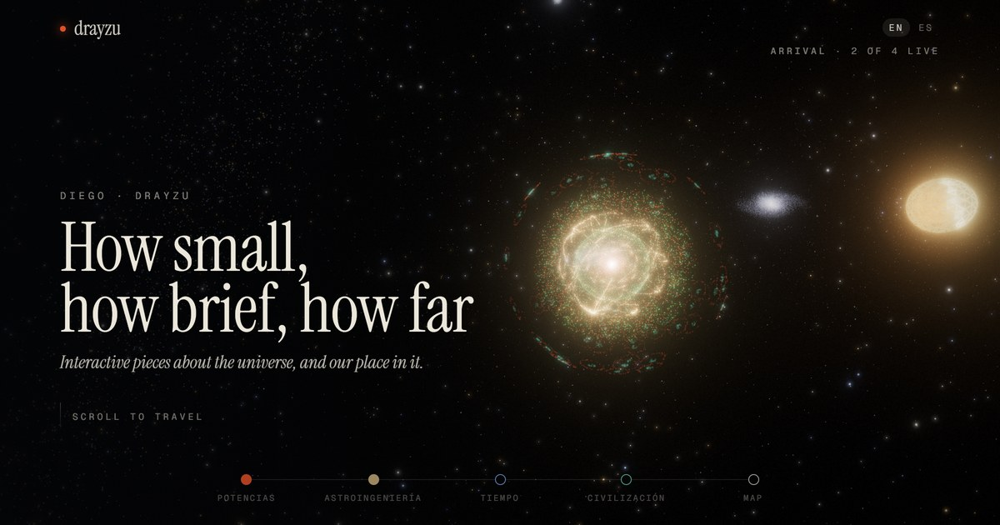

  

How it's made

 

- One continuous camera flight in Three.js: scrolling moves the camera between the four pieces of the series.
- Pieces still in progress are nebulae that condense as you approach; entering a live piece dives into it.
- Everything is particles and shaders, with bloom, a little grain, and a plain list for browsers without WebGL.
- English and Spanish. `npm install`, `npm run dev`; pushing to `main` deploys to GitHub Pages.

